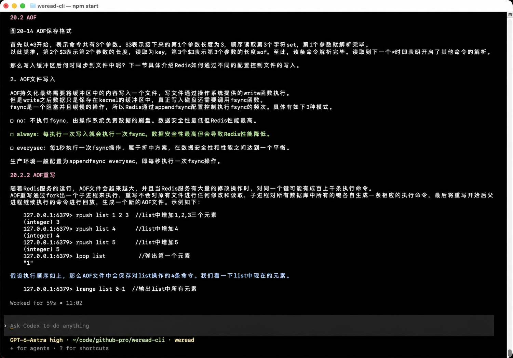
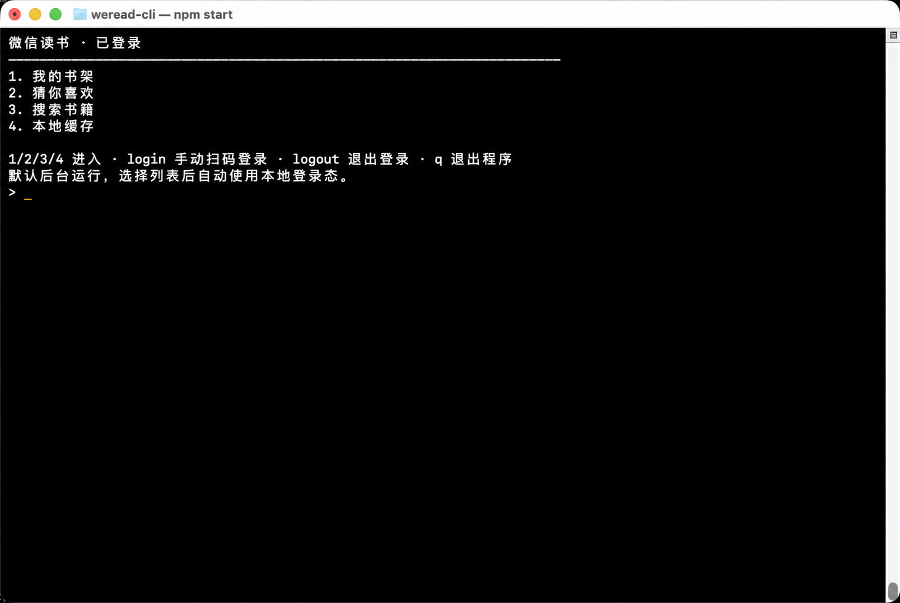
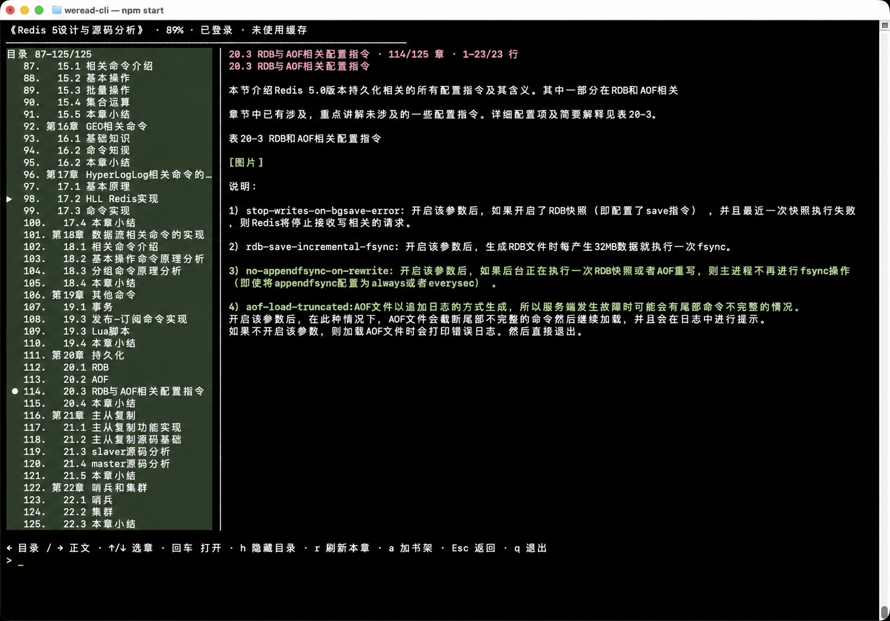
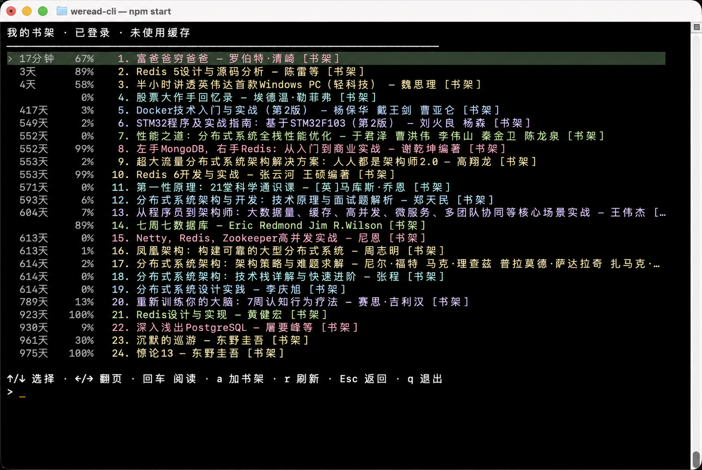

# WeRead CLI · 微信读书终端阅读器

**看起来在用 Codex CLI 开发，实际上在读微信读书。🐟**

WeRead CLI 是非官方微信读书（WeRead / WeChat Reading）终端阅读器，也是一款工作间隙的**摸鱼读书神器**。扫码登录自己的账号，就能在终端浏览书架、搜索书籍、阅读正文。

输入 `h` 收起目录，切换到高度还原 **Codex CLI 风格**的阅读界面，让读书融入日常开发场景。程序在本机运行，无需大模型 API Key，不消耗模型 token。

支持键盘翻页、鼠标滚动、章节导航、离线缓存与阅读位置续读。

## 界面预览

按 `h` 收起目录，切换到 Codex CLI 风格的阅读界面。



<details>
<summary>查看主菜单、章节导航与书架</summary>

从主菜单进入书架、推荐、搜索或本地缓存。



左右切换目录与正文焦点，上下选章，回车打开。



书架显示阅读进度与上次阅读时间，上下选书、回车阅读。



</details>

图片基于实际截图经 AI 脱敏处理，已移除标题栏中的本机路径及透出的后台内容。

## 快速开始

需要 **Node.js 20+**、**Google Chrome** 和微信读书账号。主要在 macOS 上使用，其他平台尚未系统验证。

```bash
git clone https://github.com/Ten2016/weread-cli.git
cd weread-cli
npm ci --ignore-scripts
npm start
```

主菜单输入 `login` 并回车，在浏览器扫码登录；随后输入 `1` 打开书架，上下选书、回车阅读。下次启动会复用登录态。

## 基本操作

文字命令需要回车，方向键、Esc 和鼠标滚轮直接生效。

| 场景 | 操作 |
| --- | --- |
| 书籍列表 | 上下选书，左右翻页，回车打开 |
| 显示目录 | 左右切换焦点；目录上下选章、回车打开，正文上下翻页 |
| 隐藏目录 | 左右翻页，上下逐行滚动；`?` 查看快捷键 |
| 阅读中 | 滚轮滚动，`h` 切换隐藏模式，`r` 重新加载本章 |
| 返回 / 退出 | Esc 返回，`q` 或 Ctrl+C 退出 |

## 使用须知

- 仅支持账号有权限阅读的文字书籍，不支持 PDF、漫画和有声书。
- 已读章节可离线重读，再次打开时回到上次阅读的位置。
- 登录态与缓存保存在本机 `.data/`，请勿公开分享。

[更新日志](CHANGELOG.md) · [贡献指南](CONTRIBUTING.md) · [MIT 许可证](LICENSE)
